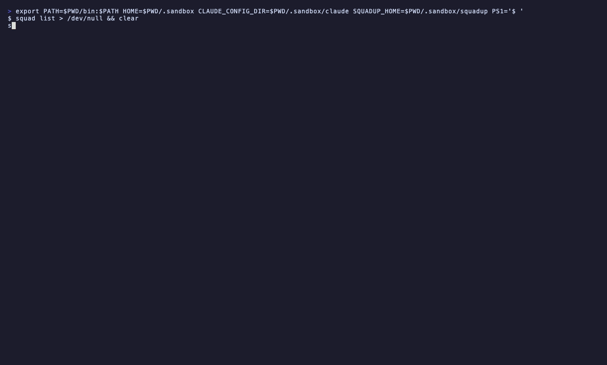
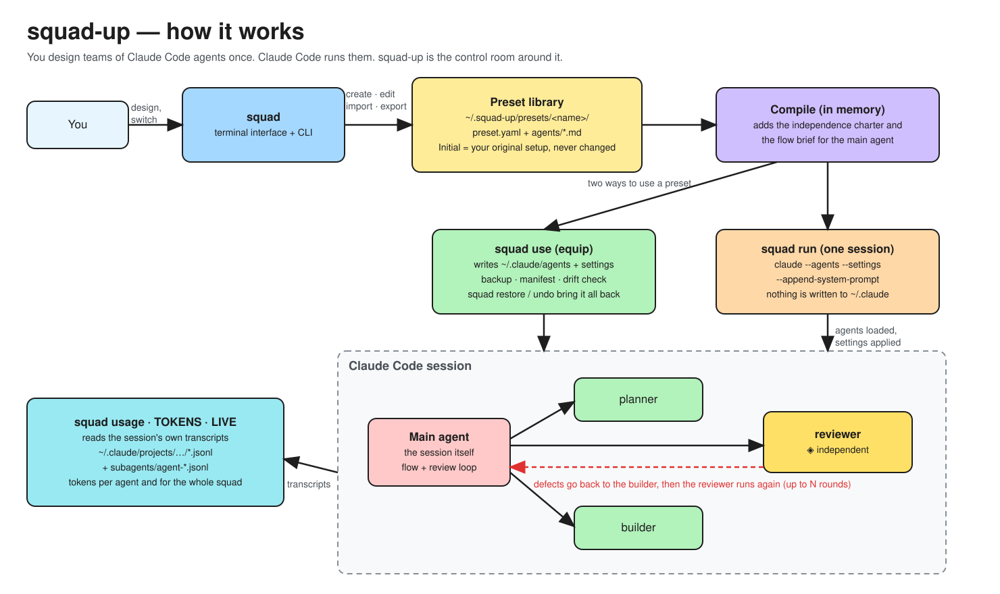
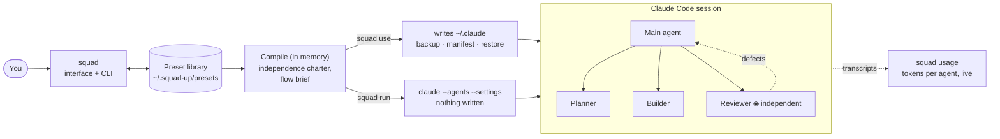

<div align="center">

# squad-up

**Switch Claude Code agent teams with one command, and always get your original setup back.**

Build teams of agents, give each its model, tools and rules, let a main agent lead them through a review loop,<br>
watch every agent's tokens live, and share the whole team as one file.

[](https://github.com/EdrenaVosh/squad-up/actions/workflows/ci.yml)
[](https://github.com/EdrenaVosh/squad-up/releases)
[](LICENSE)


[Install](#install) · [Quick start](#quick-start) · [How it works](#how-it-works) · [Features](#features) · [Commands](#commands) · [Safety](#safety-and-privacy) · [FAQ](#faq)

<!--
  Record the demo with `vhs docs/demo.tape` (see the file), then uncomment:
  
-->

</div>

---

## Why squad-up

[Claude Code](https://code.claude.com) can delegate work to *subagents*: small specialists defined by a Markdown file with a name, a description, a model, some tools and a prompt. They are powerful, but they live as loose files in `~/.claude/agents`, and everything around them is manual:

- you want a **planner, a builder and a reviewer** for one project and a **debugger and a tester** for another, but swapping files by hand is slow and easy to get wrong;
- you can't tell what a change did to your config, or get back to *how it was before*;
- a **code review** is only worth something if the reviewer is not swayed by how the code was written, and nothing helps you set that up;
- you have no idea **which agent spent your tokens**;
- sharing a team with a colleague means sending a folder of files and a list of instructions.

squad-up is a small command-line tool and terminal interface that fixes those things. You keep **presets**: named teams of agents with their settings. One command equips a preset, another puts your original setup back exactly as it was.

| | |
| --- | --- |
| **Switch teams in a second** | `squad use bug-hunter`, work, `squad use feature-creator`. Or try a preset for a single session without writing anything. |
| **Never lose your setup** | The first run saves your current config as *Initial*. Every change is backed up, manual edits are detected and never overwritten without asking, and `squad restore` returns the original. |
| **Teams that work as a team** | A main agent can hand work down the agents in order and run a **review loop**: the reviewer finds defects, the builder fixes them, until it is clean or the rounds run out. |
| **Impartial agents** | Mark an agent **independent** and it is told to work from its task alone, and whoever calls it is told to give it nothing from other agents' reasoning. |
| **See the tokens** | A live report of what the main session and each subagent spent, read from Claude Code's own transcripts. Nothing is estimated. |
| **Share a team as one file** | Export a preset, send it, import it after a preview that flags anything risky. Two ready-made teams are built in. |

## Install

Requires [Claude Code](https://code.claude.com/docs) (squad calls the `claude` command). Tested with Claude Code 2.1.

**Homebrew** (macOS, Linux)

```sh
brew install EdrenaVosh/tap/squad-up
```

**Install script** (macOS, Linux): downloads the release, checks its checksum, installs to `~/.local/bin`

```sh
curl -fsSL https://raw.githubusercontent.com/EdrenaVosh/squad-up/main/scripts/install.sh | sh
```

**Go**

```sh
go install github.com/EdrenaVosh/squad-up/cmd/squad@latest
```

**Prebuilt archives** for macOS, Linux and Windows are on the [releases page](https://github.com/EdrenaVosh/squad-up/releases) (`.tar.gz`, and `.zip` for Windows).

**From source**

```sh
git clone https://github.com/EdrenaVosh/squad-up && cd squad-up
make install            # builds and copies squad to ~/.local/bin
```

Every install gives you two names for the same program: **`squad`** (short, used in this README) and **`squad-up`** (the project name, for a shell where `squad` is already taken).

Check it works:

```sh
squad --version
squad doctor            # finds claude, its version and whether you are logged in
```

Update later with `squad update`, which tells you the right command for the way you installed it. It downloads nothing itself.

<details>
<summary><b>Optional: the Claude Code plugin</b></summary>

A small plugin adds `/squad-up:squad` inside a Claude Code session: show the equipped preset, or switch with `/squad-up:squad bug-hunter`. It only calls the `squad` tool, so squad must be installed.

```sh
claude plugin marketplace add EdrenaVosh/squad-up
claude plugin install squad-up@squad-up
```

</details>

## Quick start

```sh
squad                          # first run: saves your setup as Initial, then opens the interface
```

Nothing is changed by that first run. squad-up copies what it finds in `~/.claude` (agents and a few settings) into `~/.squad-up` and says so. From the welcome screen create a first preset from your current setup, from a starter template, or from scratch.

Or do it from the command line:

```sh
squad templates                            # the two ready-made teams
squad new bugs --template bug-hunter      # a copy you can edit
squad lint bugs                            # check it for mistakes
squad use bugs                             # equip it (shows what changes, backs up first)
claude                                     # work as usual, with the team
squad restore                              # back to exactly how it was
```

Prefer not to touch `~/.claude` at all? Run a preset for one session:

```sh
squad run bugs                             # starts claude with the preset; nothing is written
squad run bugs -- --model opus             # everything after -- goes to claude
```

Pin a preset to a project and `squad run` needs no name there:

```sh
cd my-project && squad pin bugs && squad run
```

## How it works





1. **A preset is a folder** in `~/.squad-up/presets/<name>/`: a `preset.yaml` (default model, effort, permissions, the order of the agents, an optional main agent and flow) and one Markdown file per agent, in exactly the format Claude Code reads. Your original setup is kept as the read-only preset *Initial*.
2. **squad compiles it** when it hands it to Claude Code: it adds the independence charter to independent agents and the team brief to the main agent. The files you stored stay as you wrote them.
3. **Two ways to use a preset.**
   - `squad use` **equips** it: writes the agents and the settings it manages into `~/.claude`, after a lock and a backup, with a manifest of exactly what it wrote. `squad undo` goes back a step, `squad restore` returns Initial.
   - `squad run` passes the agents (`--agents`), the settings (`--settings`) and the team brief (`--append-system-prompt`) on the command line of one `claude` session. Nothing is written.
4. **Claude Code runs the team.** squad is not in the loop at runtime. The main agent delegates, subagents work in their own clean windows and answer the main agent, which carries every result to the next one.
5. **squad usage** reads the session transcripts that Claude Code writes anyway, so it shows the tokens each agent spent while the team works.

## Features

### Presets and agents

**Name a preset anything you like**: capitals, spaces, symbols, any alphabet (`Cube creator: v2 ★`). A short id for commands and folders is made from it and shown as you type (`cube-creator-v2`); `squad new "Cube creator"` works the same way. A preset holds the agents of a team and what goes with them: a default model, effort, a permission profile (from "asks a lot" to "asks nothing", shown as a bar from green to red), and `mode: replace` (your own agents are put aside while it is equipped) or `extend` (they stay next to it).

The agent editor shows every field of an agent file with a plain explanation of its values: name, description (with hints on how to make Claude call it), model, effort, permission mode, tools and disallowed tools as checkboxes, max turns, color, and the prompt. A prompt can be **written in the interface, edited in `$EDITOR`, or loaded from a Markdown file** (drop the file on the terminal, or type its path). Every change is saved at once, and `p` previews the file exactly as it will be written.

```sh
squad edit bugs reviewer                              # the editor of one agent
squad edit bugs reviewer --prompt-file review.md      # replace its prompt from a file, no interface
```

### The interface

Run `squad` in a terminal. Presets on the left, the selected preset's agents as equally sized, readable tiles on the right (the selected one is outlined in a bright double border), panels for settings, live tokens, what equipping would change, and health. It animates (a flowing gradient, and a small orange Claude-style mascot hard at work in the tiles of an equipped preset); `SQUAD_UP_NO_ANIM=1` keeps it still, and `NO_COLOR`, `CI`, a dumb terminal or a pipe get plain text. It works from 80×24 up and grows with the terminal.

Keys: arrows or the mouse select, `enter` opens, `e` equips (with a preview), `t` tries a preset for one session, `a` edits the selected agent, `u` opens live tokens, `m` checks your models, `n` creates, `i` imports, `x` exports, `?` helps.

### Team flow and the review loop

Give a preset a **flow** and its main agent leads the team: work goes down the slots in order. With a **review loop** you name who *checks* (the gate) and who *fixes*, and a number of rounds (3 by default):

```sh
squad flow bugs --gate reviewer --fix fixer --rounds 3
```

After the gate runs, the main agent sends only its defects to the fixer and runs the gate again, until it is clean or the rounds are spent; then it stops and shows what is still open. The interface draws this as a diagram of the agents with an arc from the reviewer back to the fixer.

> **Honest note.** The order and the loop are instructions in the main agent's prompt, not code that squad runs: Claude Code runs the session. In practice a model follows them, but nothing forces it to. The reviewer and the fixer never call each other; the main agent carries every result between them.

### Independent agents

Some agents must not be swayed by what others reasoned: a code reviewer, an auditor, a second opinion. Switch **Independent** on for such an agent:

```sh
squad edit bugs reviewer --independent        # --independent=false undoes it
```

A subagent never sees the conversation, only the task its caller writes for it. So independence is done in three places, all in text: the agent's system prompt gets a short charter (work from the task and instructions, don't rely on or ask for other agents' conclusions, say what is missing instead of guessing, be impartial); its description tells whoever calls it to give only the task and instructions; and the main agent is told which agents are independent and to give them nothing from other agents' reasoning. Its tools, `CLAUDE.md` and repository access stay as they are, so it can still follow review rules kept in your repository if its prompt says where they are. Claude Code does not enforce any of this, and a model can ignore it.

### Live tokens, session by session

```sh
squad usage --watch        # or press u on the main screen
```

A live screen with the **sessions of the folder** in a list (when each began, what it has spent, what it was first asked, and a working mascot while it runs) and, for the selected one, the main session and every subagent: state, runs, tokens sent, read from the cache, produced, the total, each one's share of the squad, and the cache hit rate. The list follows the disk: a session that starts appears within a second, one that is deleted goes away, and your selection stays on its session. Session ids are not shown there, because there can be many; `z` starts counting the selected session from now, which measures one task. The main screen has a small panel with the newest session.

On the command line, `squad usage` prints the newest session of the folder, `squad usage --list` lists the sessions with their ids and first prompts, and `squad usage --session <id>` (or `--json`) shows a particular one.

The numbers are **not estimated**. Claude Code records the API's own token counts for every message, and squad reads them from `~/.claude/projects/<project>/<session>.jsonl` and `<session>/subagents/agent-<id>.jsonl`. Like Claude Code's own count, *total* is fresh input plus cache writes plus output; cache reads, which cost a fraction, are shown beside it.

### Models, by family or by release

Pick `sonnet` and you follow the newest Sonnet. Or pin a release by its full ID: Sonnet 5.5, Sonnet 5, Opus 5.5, Opus 4.6, Haiku 5.5, Fable 5.1 and the others Claude Code documents. The pickers list the aliases first and then the releases. Claude Code has no command that lists what your account can use, so squad finds out by asking: `squad models --probe` (the four aliases) or `--releases` (the older ones by full ID), or press `m` in the interface. It shows each model being asked and the answer or the reason. Each request is a full `claude -p` run, roughly 20k tokens, mostly cached, so squad asks before it does it. Models you can't use are greyed out when you pick one, and `squad run` warns when a preset names one.

### Share a team

```sh
squad export bugs                       # bugs.squad.json; --all for every preset, --gist for a secret gist (needs gh)
squad import bugs.squad.json            # or an https link, gist:<id>, or - for stdin
```

Import shows a **preview** first: the agents, the settings it would set, and warnings. It never equips what it imports, strips `hooks` and `mcpServers` from agents unless you pass `--allow-hooks`, and refuses a preset that skips permission prompts unless you pass `--accept-risks`. Export scans for things that look like secret keys and stops. Two starter templates ship with squad (`squad templates`), and the first option of the *New preset* dialog is to start from one.

### Starter templates

Both are review loops with an independent reviewer, with prompts written to be unambiguous for Claude: what each agent receives, how it works, its rules, and the exact sections of its report.

| | **Bug Hunter** | **Feature Creator** |
| --- | --- | --- |
| For | Finding and fixing a bug | Building a feature |
| Agents, in order | **debugger** (Opus) finds the root cause and describes it, changes nothing → **fixer** (Sonnet) decides the fix and makes it, never touches tests → **reviewer** (Sonnet, ◈ independent) checks the fix for logic and architecture and sends critical defects back to the fixer → **tester** (Sonnet) runs the unit and integration tests, repairs tests the fix made outdated and adds a regression test | **planner** (Opus) studies the code and writes an ordered plan, no code → **executor** (Sonnet) implements the plan and covers it with tests → **reviewer** (Sonnet, ◈ independent) checks the code and sends critical defects back to the executor |
| Review loop | reviewer ⇄ fixer, up to 3 rounds, then on to the tester | reviewer ⇄ executor, up to 3 rounds |

```sh
squad new bugs --template bug-hunter
squad new feature --template feature-creator
squad run bugs        # or squad use bugs, and then claude
```

Neither template has a main agent, so the flow reaches Claude Code through `squad run`; to equip one and keep the flow, give it a main agent in the preset screen.

### The rest

- **Linter.** `squad lint` catches the mistakes that make an agent useless: no description that says when to call it, a misspelled field Claude Code silently ignores, two agents that sound alike, a model name Claude Code won't accept, a main agent that can't delegate.
- **Manual edits are safe.** If you changed a file squad wrote, `squad use` tells you and asks: keep your edits in the preset, or discard them. Never silently.
- **`squad log` and `squad undo`.** Every change to your config is journaled; go back one step or to any point.
- **Status line.** `squad statusline enable` shows `◆ <preset>` in Claude Code's status line; your own line keeps running first.
- **Project pin.** A `.squad-up` file with one preset name, safe to commit.

## Commands

| Command | What it does |
| --- | --- |
| `squad` | Open the terminal interface |
| `squad list` | Presets; the equipped one is marked, Initial is last |
| `squad status` | Equipped preset, manual edits, the `claude` in use |
| `squad use <preset>` | Equip a preset (`--dry-run`, `--yes`, `--force`, `--save-edits`, `--discard-edits`) |
| `squad restore` | Return to your original setup (Initial) |
| `squad undo [--to <id>]` | Go back one step, or to a point from `squad log` |
| `squad run [preset] [-- args]` | Start `claude` with a preset for one session; writes nothing to `~/.claude` (`--dry-run`) |
| `squad new [name]` | Create a preset: blank, or from `--from <preset\|initial\|current>` or `--template <id>` |
| `squad clone <preset> <new>` · `rename` · `rm` | Copy, rename or delete a preset (Initial is never changed) |
| `squad edit <preset> [agent]` | Edit in the interface (`--raw`: in `$EDITOR`; `--prompt-file <file.md>`; `--independent[=false]`) |
| `squad flow <preset>` | Show or set the team flow: `--order`, or `--gate <agent> --fix <agent> [--rounds n]`, `--off` |
| `squad usage` | Tokens per agent for a session (`--watch` opens the live screen of all sessions; `--list`, `--session <id>`, `--dir`, `--json`) |
| `squad models` | Which models you can use (`--probe`, `--releases`, `--json`) |
| `squad lint [preset]` | Check agents and presets (`--strict`, `--json`) |
| `squad templates` | The two starter presets |
| `squad export [preset]` | Write a preset to `<name>.squad.json` (`-o -`, `--all`, `--gist`) |
| `squad import <file\|https-link\|gist:id\|->` | Add a shared preset after a preview (`--as`, `--force`, `--allow-hooks`, `--accept-risks`) |
| `squad card <agent>` | An agent as a card: role, model, tools, permission strength |
| `squad capture <name>` | Save the current Claude Code setup as a preset |
| `squad pin <preset>` | Pin a preset to this project (`--clear`) |
| `squad statusline enable\|disable\|status` | Show the equipped preset in Claude Code's status line |
| `squad log` | Operations that changed your config, newest first |
| `squad initial [--recapture]` | Show your original setup, or capture it again |
| `squad doctor` | Check that Claude Code is installed and logged in |
| `squad update` | Show how to update squad |

`squad <command> --help` has the details. Global flags: `--claude-dir`, `--home`, `--no-color`, `-y/--yes`.

**Environment:** `CLAUDE_CONFIG_DIR` (where Claude Code's config lives, default `~/.claude`), `SQUAD_UP_HOME` (where presets live, default `~/.squad-up`), `SQUAD_UP_NO_ANIM=1`, `NO_COLOR`.

## Safety and privacy

- **Every write to `~/.claude` is guarded:** lock, backup, atomic write, manifest. A crash in the middle rolls back from the backup. Only files squad wrote, or files byte-identical to your Initial snapshot, are ever removed.
- **What it never touches:** `env`, `hooks`, `enabledPlugins` and `~/.claude.json` are neither read into logs nor written. The status line is changed only when you run `squad statusline enable`.
- **Imported presets never run code.** Hooks and MCP servers are stripped unless you allow them, dangerous permission modes need your consent, and `--yes` alone never counts as consent.
- **No telemetry.** The network is used only for what you ask: an `https` or gist import, a gist export through `gh`, and the model check (which talks to Claude through your own `claude`).

## FAQ

<details>
<summary><b>Does squad change how Claude Code works?</b></summary>

No. It writes the same agent files and settings you would write by hand, or passes them on the command line for one session. Claude Code does the running.

</details>

<details>
<summary><b>What is the difference between <code>use</code> and <code>run</code>?</b></summary>

`squad use` equips a preset into `~/.claude`: it applies to every session until you switch or restore. `squad run` starts one session with the preset and leaves your config alone. Start with `run` if you want to try a team safely. With `use`, the agent files are picked up by a running session within seconds, but the model and permission settings are only certain to apply in a new session.

</details>

<details>
<summary><b>Is the review loop guaranteed?</b></summary>

No: it is an instruction to the main agent (see [Team flow](#team-flow-and-the-review-loop)). A preset equipped without a main agent has nobody to carry it; `squad run` passes it on the command line.

</details>

<details>
<summary><b>Will it work on Windows?</b></summary>

Release archives are built for Windows (`.zip`) and the test suite builds there, but the interface has been exercised mostly on macOS and Linux. Reports are welcome.

</details>

<details>
<summary><b>Where is everything stored?</b></summary>

Presets in `~/.squad-up/presets/<name>/`, your original setup in `~/.squad-up/presets/initial/`, backups and the journal under `~/.squad-up`, and the model check cache there too. Delete `~/.squad-up` and squad forgets everything; `~/.claude` stays as it is.

</details>

## Development

Everything below runs against a throwaway sandbox, never your real `~/.claude`. See [CONTRIBUTING.md](CONTRIBUTING.md).

```sh
make build              # ./bin/squad
make test               # golangci-lint, go vet, go test -race
make sandbox-reset && make sandbox-presets && make try    # the interface on a fake Claude config
make snapshot           # a local release build of all platforms into dist/; publishes nothing
```

Requires Go (see `go.mod`), `golangci-lint` v2 and `goreleaser` v2. The design is in [`PLAN.md`](PLAN.md), the reasons behind the choices in [`docs/DECISIONS.md`](docs/DECISIONS.md), and the history of releases in [CHANGELOG.md](CHANGELOG.md).

## License

[MIT](LICENSE) © EdrenaVosh
